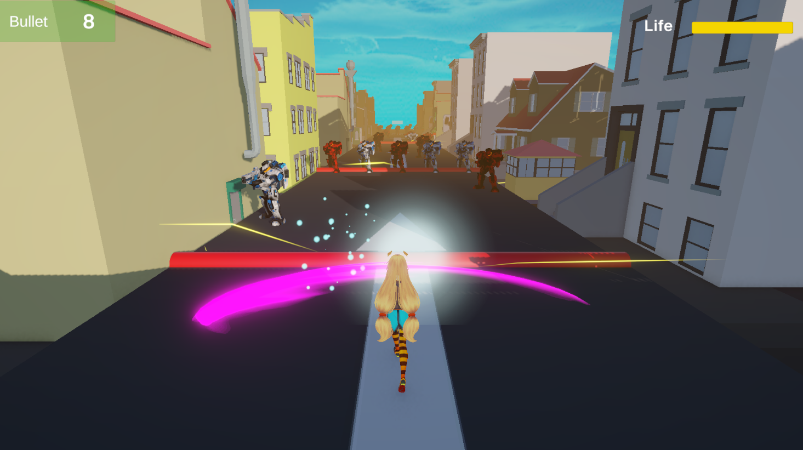
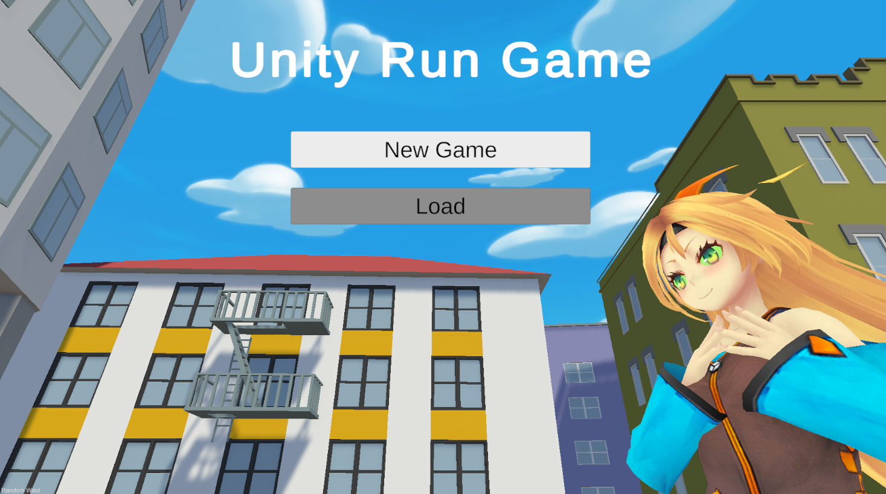
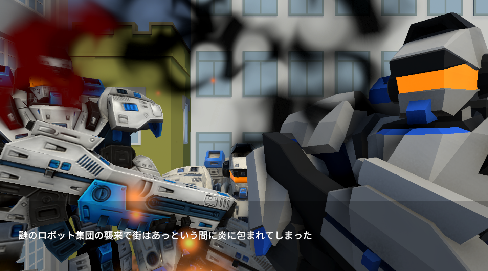
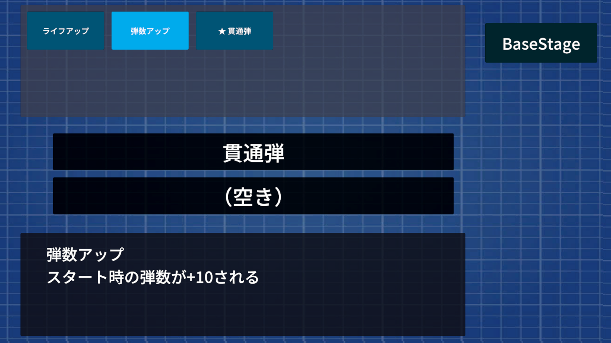
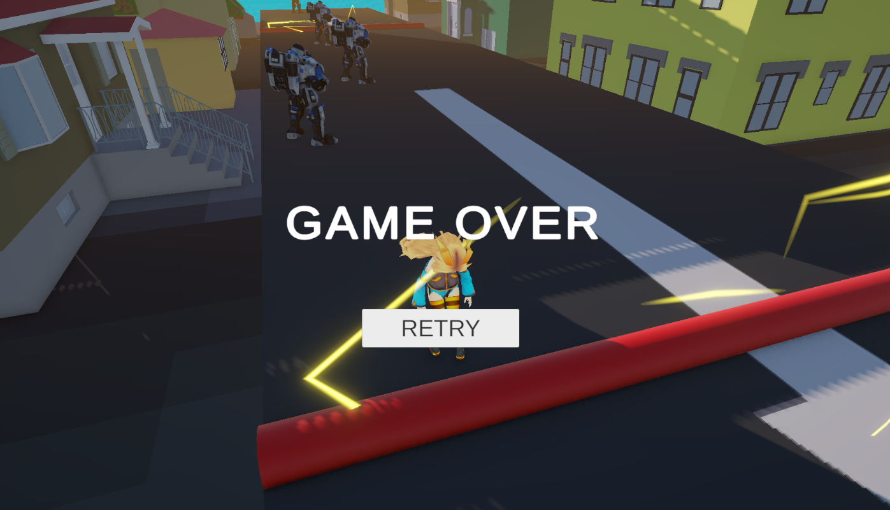
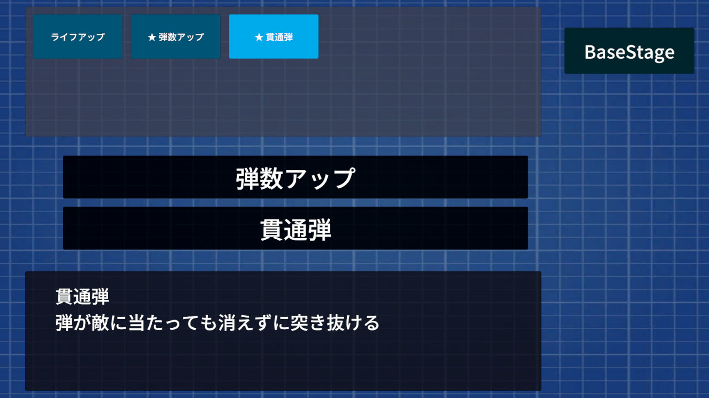
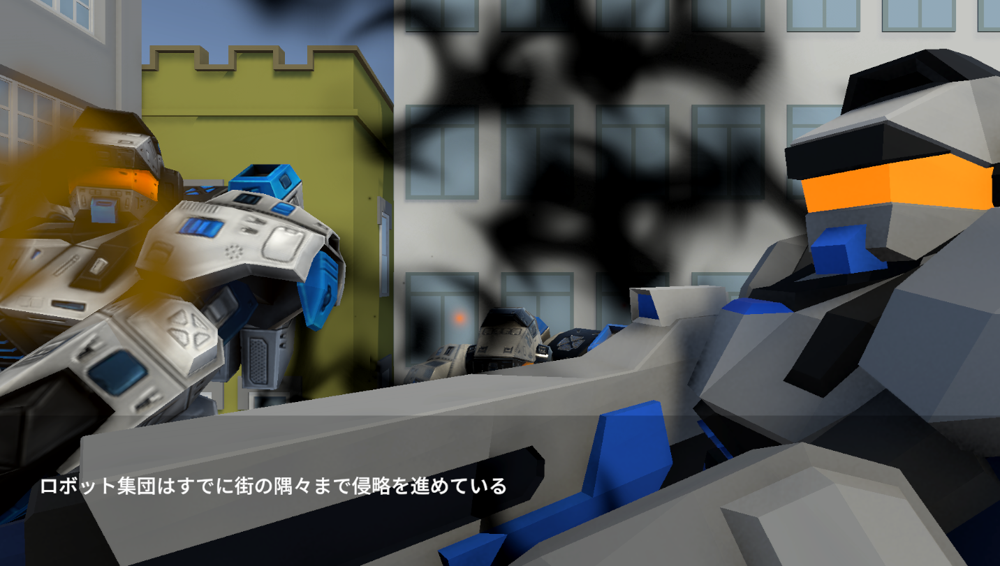
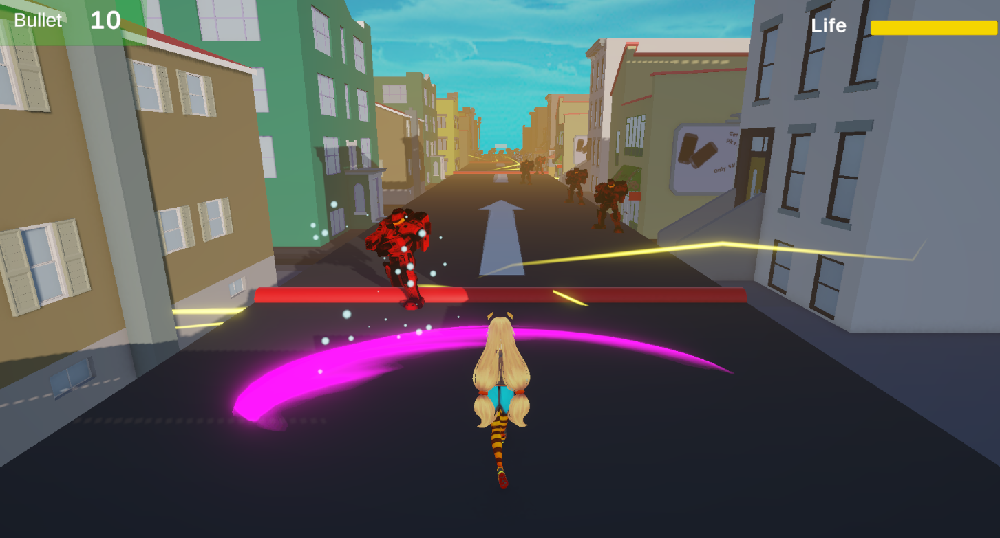

<!-- タイトル -->

# Unity Run Game

<!-- 段落の中央ぞろえはpを使う -->
<p align="center">
  「ロボットに支配された街から脱出できるか！？」Unityちゃんを操作して、ロボットに封鎖された街から脱出する爽快ランゲームです！
</p>

<p align="center">
  
  
  
  
  
</p>

## 目次

- [概要](#概要)
- [スクリーンショット](#スクリーンショット)
- [遊び方](#遊び方)
- [主な機能](#主な機能)
- [技術的なポイント](#技術的なポイント)
- [開発環境](#開発環境)
- [実行方法](#実行方法)
- [ディレクトリ構成](#ディレクトリ構成)
- [苦労した点と解決方法](#苦労した点と解決方法)
- [今後の改善予定](#今後の改善予定)
- [この制作で学んだこと](#この制作で学んだこと)
- [使用素材・クレジット](#使用素材クレジット)

## 概要

Unityのテキストをベースに改造した、見下ろし型（トップビュー）の3Dアクションゲームです。<br>
テキストは単に走って回避するしかないものですが、このゲーム

- **セーブ／ロード機能**
- **攻撃手段（ショット(弾数あり)/近接スラッシュ）**
- **アイテムによる弾数回復/体力回復**
- **ステージ開始前のインターミッション（強化アイテムの装備選択による戦略性)**
- **ストーリーパート**

など設計追加しました。

| 項目                 | 内容                                    |
| -------------------- | --------------------------------------- |
| ジャンル             | 見下ろし型3Dアクション                 |
| 制作期間             | 2026年10月〜（約2週間）                 |
| 制作人数             | 1人                                     |
| 担当範囲             | 全般                                    |
| 使用言語             | C#                                      |
| Unityバージョン      | 6000.3.24f1                             |
| 対応プラットフォーム | Windows（キーボード／ゲームパッド対応） |

> [!NOTE]
> 教材をなぞるだけでなく、「こちらから攻撃できることで　回避か？排除か？ という一瞬の判断」「強化アイテムの入手状況のセーブによってアイテム収集の意欲」「ランダムに生成されるアイテムや敵の配置」など、
> ゲームとしてより楽しいと思える要素を**独自に加えて実装**したことが、この作品の見どころです。

## スクリーンショット

|                       タイトル画面                        |                        インターミッション                        |
| :-------------------------------------------------------: | :----------------------------------------------------: |
|  |  |
|               **ストーリーパート**                |                       **ゲームプレイ**                       |
|  |      |

## 遊び方

自動で前進するプレイヤーを操作して**立ちふさがる敵**、**トラップ**を回避、あるいは排除しながらゴール地点を目指します。<br>
その場限りの補充アイテム（弾薬、回復）の他、一度手に入れれば装備できる**強化アイテム**を収集することで、ステージ間のインターミッションで装備、プレイヤーを強化した状態でステージを楽しむことができます。<br>
ステージが終わるとアイテム収集状況やステージクリア状況が自動セーブされます。

### 操作方法

| 操作                             | キーボード                  | ゲームパッド                    |
| -------------------------------- | --------------------------- | ------------------------------- |
| 移動                             | `W` `A` `S` `D` ／ 矢印キー | 左スティック ／ 十字キー        |
| 弾丸を放つ　　　　　　　　　　　　　 | `Enter`                     | Westボタン（Xbox: X ／ PS: □）  |
| 剣で斬る                         | `Space`                     | Southボタン（Xbox: A ／ PS: ×） |
| メニュー選択・決定               | 矢印キー ＋ `Enter`         | 十字キー ＋ 決定ボタン          |


## 主な機能

- **アクション**
    - 左右移動と、状況に合わせたキャラクターアニメーション
    - 弾丸：進行上にいる遠くの敵を排除できるが、弾数に限りがあるので補充アイテムが必要
    - 剣：近接攻撃と斬撃エフェクト、敵を一撃で排除できるが当たり判定が短いので判断が必要
    - ジャンプ：地面のトラップを回避できるが、ジャンプ力はそれほどではないのでタイミングが重要
- **アイテム**
    - 補充アイテム（弾薬・回復）が出現
    - 強化アイテム　（弾数アップ、体力アップ、貫通弾）など効能　インターミッション画面で2つだけ選択可能
- **インターミッション**
    - 強化アイテムの装備　空きスロット2つに対して、ゲーム中に収集した強化アイテムを選択できる
    - ステージセレクト　クリアしたステージには印がつくので全ステージ制覇を目指す
- **敵**
    - ロボット　ランダムに発生、時にライン全部を埋めてくるので排除するか、回避するか判断を求められる
    - トラップ　ランダムに地面に配置、ジャンプ回避必須だがロボットとあわさると排除と回避の両方が求められる
- **セーブ／ロード**
    - ステージをクリアするとオートセーブ、**収集したアイテム、クリアステージ**を記憶する
    - タイトルの Load で**最後にセーブした状態でインターミッション画面に入れる**
    - セーブデータがないときは Load ボタンを押せないように制御

## 技術的なポイント

テキストベースでは固定配置の敵をキャラクターが回避して走行距離を競う形です。<br>
この作品はゲームプレイが快適になるように以下の機能を独自に考え、実装しました。

### 1. セーブ／ロードの仕組み（独自設計）

ゲーム全般の管理をするGameData.csにて、Saveメソッドを作りPlayerPrefsの機能を利用

- **獲得アイテム情報**を管理するownedUpgradesリストから、アイテム名を抽出しString.Joinで結合、また**クリアステージ名**を管理するclearStagesリストをString.Joinで結合します。
それぞれ結合時にて','区切りを入れながら結合し、PlayerPrefs.SetStringを保存を行います。

- ロード時はPlayerPrefs.GetStringで獲得したデータを**Split(',')**で分解し改めてリストに復元します。

```csharp
//GameData.cs（抜粋)

//===== セーブ・ロード =====

//PlayerPrefsに保存するときの名前（キー）
const string ClearStagesKey = "ClearStages";
const string UpgradesKey = "OwnedUpgrades";

//データをまっさらにする（NewGameやロードの前に使う）
public static void ResetData()
{
    ownedUpgrades.Clear();
    equippedUpgrades.Clear();
    clearStages.Clear();
}

//セーブデータがあるかどうか
public static bool HasSave()
{
    return PlayerPrefs.HasKey(ClearStagesKey);
}

//セーブ（ステージクリアのたびにGameManagerから呼ばれる）
public static void Save()
{
    //クリアしたステージ名を「,」でつないで1つの文字列にして保存
    //例："BaseStage,Stage2"
    PlayerPrefs.SetString(ClearStagesKey, string.Join(",", clearStages));

    //所持アイテムはアセットの名前を「,」でつないで保存
    //例："LifeUp,PierceBullet"
    List<string> names = new List<string>();
    foreach (UpgradeData data in ownedUpgrades)
    {
        names.Add(data.name);
    }
    PlayerPrefs.SetString(UpgradesKey, string.Join(",", names));

    PlayerPrefs.Save(); //書き込みを確定
}

//ロード（allUpgradesは、ゲームに登場する全ての拡張アイテム）
public static void Load(UpgradeData[] allUpgrades)
{
    ResetData(); //いったん空にしてから読み込む

    //「,」で区切って、クリアしたステージ名を1つずつリストに戻す
    string stages = PlayerPrefs.GetString(ClearStagesKey, "");
    foreach (string stage in stages.Split(','))
    {
        if (stage != "") clearStages.Add(stage);
    }

    //「,」で区切った名前と同じ名前の拡張アイテムを探して、所持リストに戻す
    string upgrades = PlayerPrefs.GetString(UpgradesKey, "");
    foreach (string upgradeName in upgrades.Split(','))
    {
        foreach (UpgradeData data in allUpgrades)
        {
            if (data.name == upgradeName) AddUpgrade(data);
        }
    }
}
```

### 2. 斬撃アクションの追加

- 攻撃アクションに **「斬撃」を追加** することで、弾がなくてもゲーム進行ができるようにしました。
- 斬撃は発生すると、**短い時間プレイヤーの周囲に独自の当たり判定** が発生します。
- 「PlayerSlash.cs」にて斬撃専用機能として実装、InputActionアセットのAttack・Jumpアクションは弓矢に使われていたので、Crouchアクションを斬撃に割り当てました。
- **攻撃のインターバル** をつけてバトルのメリハリを体現しています。攻撃発生時にコルーチンを起動させ、**コルーチンが発動している間は次の攻撃ができない** というつくりにしています。
- 射撃アクションは「PlayerShooter.cs」にて射撃専用機能として実装、Attackアクションを割り当て、**Bulletオブジェクトの生成**を行っています。インターバルの関g苗方などは斬撃アクションと同じです。斬撃との大きな違いは弾数管理を行っている部分になります。

```csharp
// PlayerSlash.cs（抜粋)

 public class PlayerSlash : MonoBehaviour
{    
    public GameObject slashObject; //対象スラッシュオブジェクト
    InputAction slashAction; //スラッシュのためのアクションを参照
    [Header("スラッシュ攻撃のインターバル")]
    public float slashTime = 0.5f;
    Coroutine slashStart; //スラッシュ発生コルーチンを参照する変数

    void Start()
    {   
        //PlayerInputコンポーネントに設定されている現Mapを取得
        InputActionMap actionMap = GetComponent<PlayerInput>().currentActionMap;
        //現マップ上にいる「Crouch」というアクションを取得
        slashAction = actionMap.FindAction("Crouch");
        slashObject.SetActive(false); //最初は必ずスラッシュオブジェクトを非表示
    }

    void Update()
    {
        if (GameManager.gameState == GameState.GameEnd) return;

        //該当ボタンが押されたとき
        if (slashAction.WasPerformedThisFrame())
        {
            Slash(); //スラッシュ攻撃メソッドの発動
        }
    }

    void Slash()
    {
        if(slashStart == null) //すでに攻撃中でなければ
        {
            slashObject.SetActive(true); //スラッシュとなるオブジェクトを表示
            slashStart = StartCoroutine(SlashStart()); //攻撃コルーチンの発動
        }
    }

    IEnumerator SlashStart()
    {
        yield return new WaitForSeconds(slashTime); //変数で決めた秒数待つ
        slashObject.SetActive(false); //スラッシュオブジェクトを非表示
        slashStart = null; //次の攻撃ができるようにコルーチン解放
    }
}

```


### 3. 射撃アクションの追加

- 射撃アクションは「PlayerShooter.cs」にて射撃専用機能として実装、Attackアクションを割り当て、**Bulletオブジェクトの生成**を行っています。インターバルの考え方は斬撃アクションと同じです。斬撃との大きな違いは弾数管理を行っている部分になります。

```csharp
// PlayerShooter.cs（抜粋)

public class PlayerShooter : MonoBehaviour
{
    [Header("生成される弾")]
    public GameObject bullet;
    InputAction shootAction; //Attackアクションボタンの割り振り
    Coroutine shootStart; //シュートされているかどうかを知るための変数

    [Header("弾速・インターバル時間")]
    public float bulletSpeed = 10.0f;
    public float shootInterval = 0.5f;

    const int startRemaining = 10; //初期弾数
    private int bulletRemaining = startRemaining; //弾の残数
                                                  
    //UIなどに残数を伝えるアクセサメソッド
    public int GetRemaining()
    {
        return bulletRemaining;
    }

    //弾数を回復するメソッド
    public void AddBullet(int num)
    {
        bulletRemaining += num;
    }

    void Start()
    {
        //装備リストにBulletUpがあればその分を加算
        bulletRemaining = startRemaining + GameData.GetValue(UpgradeType.BulletUp);
        //PlayerInputコンポーネントに設定されている現Mapを取得
        InputActionMap actionMap = GetComponent<PlayerInput>().currentActionMap;
        //現マップ上にいる「Attack」というアクションを取得
        shootAction = actionMap.FindAction("Attack");
    }

    void Update()
    {
        if (GameManager.gameState == GameState.GameEnd) return;
        //Attackアクションボタンが押された時 かつ 残弾があれば　Shootメソッド
        if (shootAction.WasPerformedThisFrame() && bulletRemaining > 0)
        {
            Shoot();
        }
    }

    void Shoot()
    {
        if (shootStart == null)
        {
            bulletRemaining--; //残弾を１減らす
            
            //UIControllerを探して、残弾更新メソッド
            UIController controller = GameObject.FindAnyObjectByType<UIController>();
            controller.UpdateBullet();

            //攻撃開始Bulletプレハブの生成とＺ軸前方へシュート
            GameObject obj = Instantiate(   //生成と同時にそれを変数に代入しておく
                bullet,                     //生成対象オブジェクト
                transform.position,         //生成場所※細かく指定したければGateオブジェなど用意
                Quaternion.identity);       //生成した時のRotation

            Rigidbody rbody = obj.GetComponent<Rigidbody>(); //生成したもののRigidbody
            rbody.AddForce(new Vector3(0, 0, bulletSpeed), ForceMode.Impulse); //前方に押し出す

            //インターバルとなるコルーチンの開始
            shootStart = StartCoroutine(ShootStart());
        }
    }

    //インターバル用コルーチン
    IEnumerator ShootStart()
    {
        //0.5ｆ秒待つ
        yield return new WaitForSeconds(shootInterval);
        //コルーチン変数の解放
        shootStart = null;
    }
}
```

### 4. インターミッション画面（強化アイテムのスロット選択）

ステージクリア後に表示されるインターミッション画面で、入手済みの強化アイテムから**最大2つ**をスロットにセットして、次のステージに挑むことができます。
画面の処理は IntermissionManager.cs にまとめています。

- **強化アイテムはScriptableObjectで管理**
  強化アイテム1つ分のデータ（表示名・説明文・種類・効果量）を、ScriptableObjectの `UpgradeData` で定義しています。
  新しいアイテムは、Projectウィンドウでアセットを作り、値を入力するだけで追加できます。

- **所持リストのボタンを動的に生成**
  所持アイテムの数は毎回変わるため、ボタンはシーンに置いていません。
  `GameData.ownedUpgrades` の数だけボタンのプレハブを **Instantiate** し、Horizontal Layout Group で自動的に並べています。
  画面を更新するときは、ボタンを全部消してから作り直す方式にして、表示が実際のデータとずれないようにしています。

- **ラムダ式でボタンとアイテムを結び付ける**
  インスペクターのOnClickでは、生成したボタンごとに違うアイテムを引数として渡せません。
  そこで `AddListener(() => SelectUpgrade(data))` と書き、そのボタンが表すアイテムを引数にしてメソッドを呼び出しています。

- **セット／解除のルール**
  押したアイテムがセット中なら外し、スロットに空きがあればセットします。
  スロットがいっぱいのときは、メッセージで外し方を案内します。
  セット中のアイテムには「★」を付けて表示します。

- **キーボード・ゲームパッド操作に対応**
  Input SystemのUIマップ（Navigateで選択、Submitで決定）で操作できます。
  ボタンを作り直すと選択状態が消えるため、`EventSystem.current.SetSelectedGameObject` で毎回ボタンを選び直しています。
  直前に押したアイテムのボタンを選び直すので、カーソル位置もそのまま保たれます。

- **効果の反映**
  セットした強化アイテムは、static な `GameData.equippedUpgrades` に保持し、シーンをまたいで引き継ぎます。
  ステージ開始時、PlayerRun.cs と PlayerShooter.cs の `Awake()` が `GameData.GetValue()` で効果量を読み取り、最大ライフや初期弾数に反映します。

```csharp
//IntermissionManager.cs（抜粋）

//画面を最新の状態にする（ボタンを全部消して作り直す）
void Refresh()
{
    //① 所持リストのボタンをいったん全部消す
    foreach (Transform child in listParent)
    {
        Destroy(child.gameObject);
    }

    GameObject selectTarget = null; //キー操作で選んでおくボタン

    //② 所持しているアイテムの数だけボタンを作る
    foreach (UpgradeData data in GameData.ownedUpgrades)
    {
        GameObject obj = Instantiate(upgradeButtonPrefab, listParent);

        //選んでおくボタンを決める（基本は先頭、さっき押したアイテムがあればそれ）
        if (selectTarget == null) selectTarget = obj;
        if (data == lastSelected) selectTarget = obj;

        //ボタンの文字（セット中なら印を付ける）
        string label = data.upgradeName;
        if (GameData.equippedUpgrades.Contains(data)) label = "★ " + label;
        obj.GetComponentInChildren<TextMeshProUGUI>().text = label;

        //ラムダ式で、このボタンのアイテム(data)を引数にSelectUpgradeを呼ぶ
        obj.GetComponent<Button>().onClick.AddListener(() => SelectUpgrade(data));
    }

    //アイテムを1つも持っていなければ、ステージボタンを選んでおく
    if (selectTarget == null) selectTarget = firstStageButton;

    //キー操作（Navigate/Submit）で動かせるように、ボタンを「選択中」にする
    EventSystem.current.SetSelectedGameObject(selectTarget);

    //③ スロットの表示
    for (int i = 0; i < slotTexts.Length; i++)
    {
        if (i < GameData.equippedUpgrades.Count)
        {
            slotTexts[i].text = GameData.equippedUpgrades[i].upgradeName;
        }
        else
        {
            slotTexts[i].text = "（空き）";
        }
    }
}

//所持リストのボタンが押されたとき
void SelectUpgrade(UpgradeData data)
{
    lastSelected = data; //押したアイテムを覚えておく

    //説明文を表示
    descriptionText.text = data.upgradeName + "\n" + data.description;

    if (GameData.equippedUpgrades.Contains(data))
    {
        //セット中なら外す
        GameData.equippedUpgrades.Remove(data);
    }
    else if (GameData.equippedUpgrades.Count < GameData.SlotCount)
    {
        //スロットに空きがあればセット
        GameData.equippedUpgrades.Add(data);
    }
    else
    {
        //スロットがいっぱい
        descriptionText.text = "スロットがいっぱいです。\nセット中のアイテムを押すと外せます";
    }

    Refresh(); //画面を更新
}
```

### 5. 会話パート（ScriptableObjectを使った会話システム）

オープニングなどの会話シーンを、**会話データ（ScriptableObject）** と **表示処理（TalkManager.cs）** に分けて作っています。
セリフを追加・変更するときは、スクリプトを書き換えずに、インスペクターで会話データを編集するだけで済みます。

- **会話データをScriptableObjectで管理**
  TalkData.cs で、話者名・セリフ・顔グラフィックを1組にした `SingleTalk` クラスを定義しました。
  それを `List<SingleTalk>` として持つ ScriptableObject が `TalkData` です。
  `[CreateAssetMenu]` を付けているので、Projectウィンドウの Create メニューから会話データのアセットを作れます。
  `[TextArea]` 属性で、インスペクター上でもセリフを複数行で入力できます。

- **文字送り演出（コルーチン）**
  セリフを1文字ずつ `messageText.text` に足していき、`WaitForSeconds(textSpeed)` で間を空けています。
  文字送りの速さは、インスペクターの `textSpeed` で調整できます。

- **ボタン1つで「全文表示」と「次へ」を切り替え**
  Input SystemのUIマップにある **Submit** アクションで会話を進めます。
  - 文字送りの途中で押した場合：コルーチンを止めて、全文をすぐに表示
  - 全文が表示されている状態で押した場合：次のセリフへ進む
  
  `isTyping` フラグで、この2つの動作を切り替えています。

- **顔グラフィックの出し分け**
  セリフに顔画像が設定されていれば表示し、なければ画像の枠ごと非表示にします。
  ナレーションのような、話者のいないセリフにも対応できます。

- **会話終了後のシーン遷移**
  最後のセリフまで進むと会話パネルを閉じ、少し待ってから、インスペクターで指定した `nextScene` へ移動します。
  `TalkData` と `nextScene` を差し替えれば、同じ仕組みを別の会話シーンにも使い回せます。

```csharp
//TalkData.cs

// 1つの会話データを表すクラス（インスペクターに表示するため [System.Serializable] が必須）
[Serializable]
public class SingleTalk
{
    [Header("名前・セリフ・画像")]
    public string name;

    [TextArea(2, 5)] // インスペクター上で複数行入力できるようにする属性（最小2行、最大5行）
    public string message;

    public Sprite faceImage;
}

// 会話データのリストを保持するScriptableObject
[CreateAssetMenu(fileName = "NewTalkData", menuName = "ScriptableObjects/TalkData", order = 1)]
public class TalkData : ScriptableObject
{
    public List<SingleTalk> talks = new List<SingleTalk>();
}
```

```csharp
//TalkManager.cs（抜粋）

public void AdvanceTalk()
{
    if (currentTalkData == null || currentTalkData.talks.Count == 0)
    {
        return;
    }

    //文字送りの途中なら、コルーチンを止めて全文を表示
    if (isTyping)
    {
        if (typingCoroutine != null) StopCoroutine(typingCoroutine);
        messageText.text = currentFullText;
        isTyping = false;
        return;
    }

    currentIndex++; //次のセリフへ

    //最後のセリフまで終わったら会話終了
    if (currentIndex >= currentTalkData.talks.Count)
    {
        EndTalk();
        return;
    }

    //リストのcurrentIndex番目のセリフを取り出す
    SingleTalk talk = currentTalkData.talks[currentIndex];

    if (nameText != null) nameText.text = talk.name;

    if (faceImage != null)
    {
        //顔イメージがあれば出す／なければ出さない
        faceImage.gameObject.SetActive(talk.faceImage != null);
        faceImage.sprite = talk.faceImage;
    }

    currentFullText = talk.message;
    typingCoroutine = StartCoroutine(TypeTextCoroutine(currentFullText));
}

//1文字ずつ表示する文字送り
IEnumerator TypeTextCoroutine(string text)
{
    isTyping = true;
    messageText.text = "";

    foreach (char c in text)
    {
        messageText.text += c;
        yield return new WaitForSeconds(textSpeed);
    }

    isTyping = false;
}
```

## 開発環境

| 種類           | 名前・バージョン                                    |
| -------------- | --------------------------------------------------- |
| ゲームエンジン | Unity 6000.3.24f1（Unity 6）                        |
| 言語           | C#                                                  |
| レンダリング   | Universal Render Pipeline 17.3.0　　　　　　　　　　　 |
| 入力           | Input System 1.20.0                                 |
| 主なパッケージ | Unity UI、TextMesh Pro、Cinemachine　　　　　　　　　   |
| エディタ       | Visual Studio                                       |
| バージョン管理 | Git ／ GitHub                                       |

## 実行方法

> [!IMPORTANT]
> **Unity 6000.3.24f1** で開いてください。違うバージョンで開くと、変換が走ったり正しく動かなかったりすることがあります。

1. このリポジトリをクローンします。
    ```bash
    git clone https://github.com/Dyna-Rise/RunItemGame.git
    ```
2. Unity Hub の **「追加」→「ディスクから加える」** で、クローンしたフォルダを選びます。
3. TextMeshPro の インポート Window → TextMeshPro →各種importしておきます。
4. 別配布の「RunItemGame_追加」パッケージをインポートします
5. プロジェクトを開いたら、`Assets/Scenes/Title.unity` を開いて再生ボタンを押します。

<details>
<summary>セーブデータを消したいとき</summary>

Unity エディタのメニュー **Edit → Clear All PlayerPrefs** で削除できます。
タイトル画面の Continue ボタンが押せなくなれば削除できています。

</details>

## ディレクトリ構成

```text
Assets/
├── Scenes/            # Title / Opening / BaseStage / Intermission
├── Scripts/
│   ├── PlayerRun.cs            # 5レーンの自動前進・ジャンプ・ダメージ・アニメ制御
│   ├── PlayerShooter.cs        # 弾数制のShoot攻撃
│   ├── PlayerSlash.cs          # Sword攻撃
│   ├── BulletController.cs     # 弾の消滅（貫通弾の判定）
│   ├── Enemy.cs                # 敵の体力・被ダメージ・撃破エフェクト
│   ├── StageGenerator.cs       # ステージの自動生成と削除
│   ├── EnemyGenerator.cs       # ステージ上への敵のランダム配置（横並びあり）
│   ├── ItemGenerator.cs        # ステージ上へのアイテムのランダム配置（出現確率つき）
│   ├── Item.cs                 # ライフ回復・弾補充・強化アイテムの取得
│   ├── Goal.cs                 # ゴール判定
│   ├── GameManager.cs          # ゲームの状態管理（プレイ中／クリア／ゲームオーバー）
│   ├── GameData.cs             # シーンをまたぐデータ管理とセーブ／ロード
│   ├── UpgradeData.cs          # 強化アイテムのデータ（ScriptableObject）
│   ├── IntermissionManager.cs  # インターミッション画面（スロット選択）
│   ├── StageSelectButton.cs    # ステージ選択ボタン（クリア済みに★）
│   ├── TalkData.cs             # 会話データ（ScriptableObject）
│   ├── TalkManager.cs          # 会話の表示・文字送り
│   ├── TitleController.cs      # タイトル画面（NewGame／Load）
│   └── UIController.cs         # ライフ・残弾・クリア／ゲームオーバー画面
├── Prefabs/           # DefaultStage、Enemy、Item（各種Variant）、Bullet、SlotAddButton など
├── Upgrades/          # 強化アイテムのデータ（LifeUp / PierceBullet / BulletUp）
├── Animations/        # プレイヤーの Animator Controller
├── Settings/          # URP の設定
└── AddPackages/       # 外部アセット（ユニティちゃん、エフェクトなど）
```

## 苦労した点と解決方法

| 困ったこと | 原因 | 解決方法 |
| --- | --- | --- |
| インターミッション画面で、方向キーを押しても所持アイテムの選択が移らない | ボタンのプレハブの **Navigation が None** になっていて、どの方向にも移れなかった | プレハブの Navigation を **Automatic** に変更した |
| スクリプトで生成したボタンの幅が 1 になり、文字が縦一列に折り返される | **Layout Group の子として作ったボタン**をプレハブ化したため、Layout Group が自動で決めた幅が保存されていた | プレハブを開いて Width／Height を設定し直した。UIのプレハブは Canvas 直下で作るようにした |
| アイテムを押してボタンを作り直すと、キー操作の選択が消える | ボタンを全部消して作り直すと、選択中のボタンも消えてしまう | 作り直したあとに `EventSystem.current.SetSelectedGameObject` で、直前に押したアイテムのボタンを選び直すようにした |
| ダメージを受けてもダメージアニメが見えない | 点滅演出で見た目のオブジェクトを表示・非表示すると、**Animator の状態がリセット**されていた | `animator.keepAnimatorStateOnDisable = true` を設定し、非表示にしても状態が保たれるようにした |
| ゴールやゲームオーバーのアニメが、最初の一瞬で止まったように見える | Any State からの遷移が、毎フレーム同じアニメに入り直していた | 遷移に条件（Bool）を付け、**Can Transition To Self をオフ**にした |
| ユニティちゃんを置くと、画面に表情切り替えなどのボタンが出る | モデルに付属するサンプルスクリプト（FaceUpdate／IdleChanger）が `OnGUI` で UI を描いていた | 自作の Animator と干渉するため、サンプルスクリプトを無効化した |

## 今後の改善予定

- [ ] 重力やノックバックの計算にも `Time.deltaTime` を掛け、フレームレートや `Time.timeScale` によって動きが変わらないようにする
- [ ] セーブ先を PlayerPrefs から **JSON ファイル**（`Application.persistentDataPath`）に変更する
- [ ] スロットにセットした状態もセーブする
- [ ] Scripts フォルダを Player／Enemy／UI／Data などに分けて整理する
- [ ] ステージの種類を増やし、ステージ選択を活かす
- [ ] ビルド版を配布する（GitHub Releases ／ unityroom）

## この制作で学んだこと

- Unity の基本（GameObject・コンポーネント・プレハブ・シーン）と、C# でゲームの仕組みを組み立てる方法
- プレハブを `Instantiate` して、ステージ・敵・アイテム・UIボタンを**動的に生成する**方法
- **ScriptableObject** で、データ（会話・強化アイテム）とプログラムを分けて管理する考え方
- `static` 変数で、シーンをまたいでデータを持ち回る方法と、その注意点
- `PlayerPrefs` と `string.Join`／`Split` を使った**データの保存と復元**
- ラムダ式（`() =>`）で、ボタンごとに違う引数をメソッドに渡す方法
- Input System の UI マップ（Navigate／Submit）と EventSystem による**キーボード・ゲームパッドでのUI操作**
- Animator の遷移条件（Trigger／Bool）と、スクリプトからアニメーションを切り替える方法
- うまく動かないときに、**インスペクターの設定とコードの両方から原因を切り分ける**考え方
- Git でこまめにコミットし、作業の区切りを記録すること

## 使用素材・クレジット

| 素材 | 作者・配布元 | 用途 |
| --- | --- | --- |
| ユニティちゃん 3Dモデル（Unity-chan! Model） | Unity Technologies Japan（ユニティちゃん公式サイト） | プレイヤーキャラクター・アニメーション |
| Animations Starter Pack | Blink（Unity Asset Store） | キャラクターのアニメーション |
| Slash Effects FREE | Matthew Guz（Unity Asset Store） | 斬撃エフェクト |
| Free Quick Effects Vol. 1 | Gabriel Aguiar Prod.（Unity Asset Store） | 攻撃・撃破エフェクト |
| Fantasy Skybox FREE | Render Knight（Unity Asset Store） | 背景の空（スカイボックス） |
| POLYGON city pack | （作者名）（Unity Asset Store） | 街並みのステージ |
| Sci-Fi Warrior PBR HP Polyart | Dungeon Mason（Unity Asset Store） | キャラクターモデル |

各素材の著作権は、それぞれの作者に帰属します。

 © Unity Technologies Japan/UCL
本作品は「ユニティちゃんライセンス条項」の元に提供されています。

---

